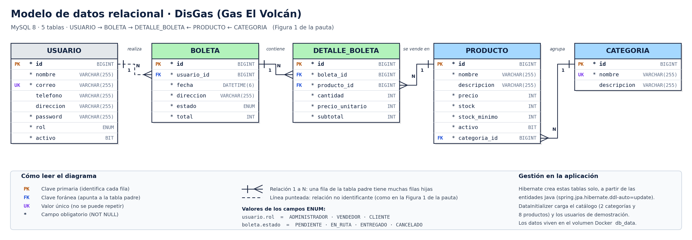
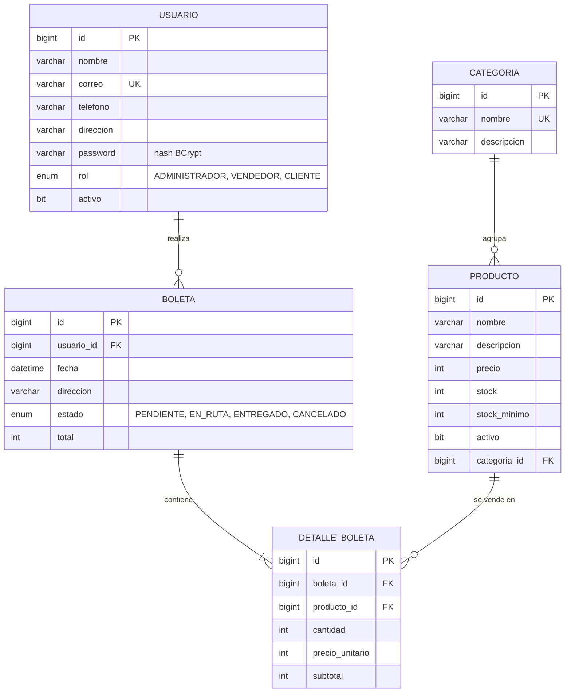

# Gestión de la base de datos

Este documento explica **qué base de datos usa DisGas, cómo se crean y llenan las tablas, y cómo revisarla**.

## 1. Modelo de datos (5 tablas, Figura 1 de la pauta)



Versión que GitHub dibuja directamente (Mermaid):



**Cómo leerlo:** un USUARIO realiza muchas BOLETAS; cada BOLETA tiene muchas líneas (DETALLE_BOLETA); cada línea corresponde a un PRODUCTO; cada PRODUCTO pertenece a una CATEGORIA.

| Tabla | Para qué sirve | Entidad Java |
|---|---|---|
| `usuario` | Clientes, vendedores y administradores. El campo `rol` decide qué puede hacer. | `model/Usuario.java` |
| `categoria` | Agrupa productos (Gas, Accesorios). | `model/Categoria.java` |
| `producto` | Lo que se vende y también el **inventario** (`stock`, `stock_minimo`). | `model/Producto.java` |
| `boleta` | El pedido de un cliente: fecha, dirección, estado y total. | `model/Boleta.java` |
| `detalle_boleta` | Cada línea del pedido, con el precio al momento de comprar. | `model/DetalleBoleta.java` |

Archivos de apoyo: `database/modelo_datos.sql` (script de referencia para importar en **SQL Developer Data Modeler** o **MySQL Workbench**) y `database/generar_diagrama.py` (genera la imagen).

## 2. ¿Dónde vive la base de datos?

| Entorno | Base de datos | Cómo se activa |
|---|---|---|
| Desarrollo (IntelliJ, `mvnw spring-boot:run`) | **H2 en memoria**: no se instala nada, se borra al apagar | perfil por defecto |
| **Docker** | **MySQL 8.4** en el contenedor `db`, con datos en el volumen `db_data` | `docker compose up --build` |
| AWS | **MySQL en RDS** | variables `DB_HOST`, `DB_USER`... |

El **mismo JAR** funciona en los tres: solo cambian las variables de entorno (`application-prod.properties`).

## 3. ¿Cómo se crean las tablas y los datos?

1. **Las tablas las crea Hibernate.** Cada clase con `@Entity` es una tabla y cada atributo una columna. Con `spring.jpa.hibernate.ddl-auto=update`, al arrancar compara las entidades con la base y crea lo que falta.
2. **Las relaciones salen de las anotaciones:** `@ManyToOne` crea la clave foránea (ej. `Producto.categoria` → columna `categoria_id`); `unique = true` crea el `UNIQUE`; `@Enumerated(STRING)` guarda el texto del enum.
3. **Los datos iniciales los carga `DataInitializer`** (`config/DataInitializer.java`) *solo si la tabla está vacía*: 2 categorías, 8 productos (cilindros, regulador, manguera, conector, abrazadera y kit) y 4 usuarios de demostración.
4. **Las reglas de integridad** las protege la base: no se puede repetir un correo ni el nombre de una categoría, y no se puede borrar una fila a la que otra apunta (el backend lo detecta antes y responde `409`).

> `ddl-auto=update` es la configuración que usa el taller del profesor. Nunca borra columnas ni datos. En una empresa real se usarían migraciones (Flyway/Liquibase).

## 4. Los datos en Docker

- Los datos están en el **volumen `db_data`**, no dentro del contenedor.
  - `docker compose down` → apaga todo, **los datos se conservan**.
  - `docker compose down -v` → apaga y **borra la base** (al volver a levantar, `DataInitializer` la rellena desde cero).
- Si cambias las entidades y algo no calza, la salida más simple en desarrollo es `docker compose down -v` y levantar de nuevo.

## 5. Cómo revisar la base de datos

**Desde la terminal** (no necesita instalar nada más):

```bash
docker compose exec db mysql -u disgas -pdisgas1234 disgas
```

Dentro de MySQL:

```sql
SHOW TABLES;                                   -- debe mostrar las 5 tablas
SELECT id, nombre, precio, stock FROM producto;   -- los 8 productos
SELECT id, correo, rol FROM usuario;               -- los usuarios (la password es un hash)
SELECT id, usuario_id, estado, total FROM boleta;  -- los pedidos
DESCRIBE detalle_boleta;                           -- estructura de una tabla
EXIT;
```

**Con una herramienta gráfica** (MySQL Workbench o DBeaver): el `docker-compose.yml` publica la base en tu computador (solo accesible desde él):

| Campo | Valor |
|---|---|
| Host | `127.0.0.1` |
| Puerto | `3307` |
| Usuario / clave | `disgas` / `disgas1234` (o lo que pongas en `.env`) |
| Base | `disgas` |

Desde Workbench puedes además hacer *Database → Reverse Engineer* para generar el diagrama de la base real.

## 6. Respaldo y restauración

```bash
# Respaldo (genera respaldo.sql en tu carpeta)
docker compose exec db mysqldump -u root -proot1234 disgas > respaldo.sql

# Restauración
docker compose exec -T db mysql -u root -proot1234 disgas < respaldo.sql
```

## 7. Seguridad de los datos

- Las contraseñas se guardan como **hash BCrypt**; la API nunca devuelve el campo `password`.
- Las credenciales no están en el código: vienen de variables de entorno (`.env`, no se sube a GitHub).
- En AWS, la base (RDS) **no tiene acceso público**: solo el backend puede conectarse (grupo de seguridad). En Docker, el puerto 3307 solo escucha en `127.0.0.1`.
